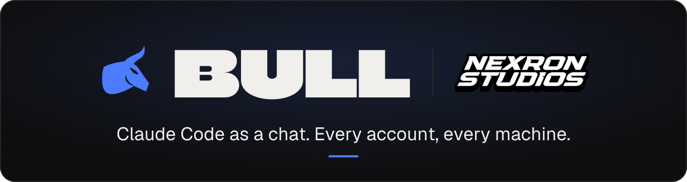
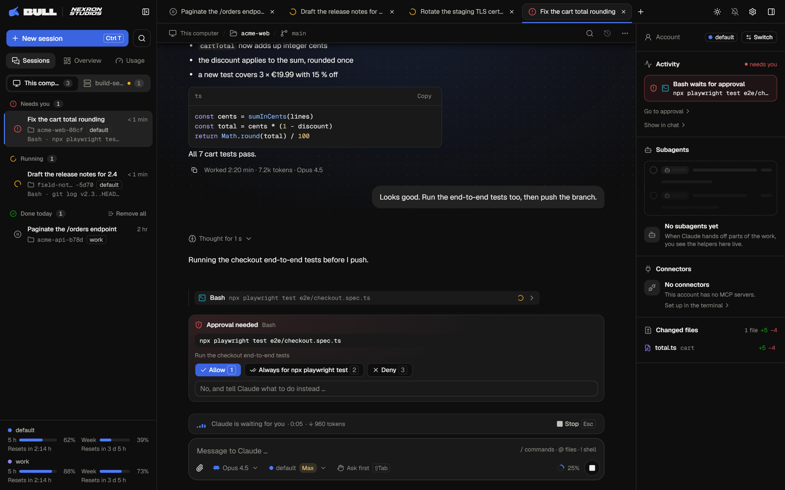
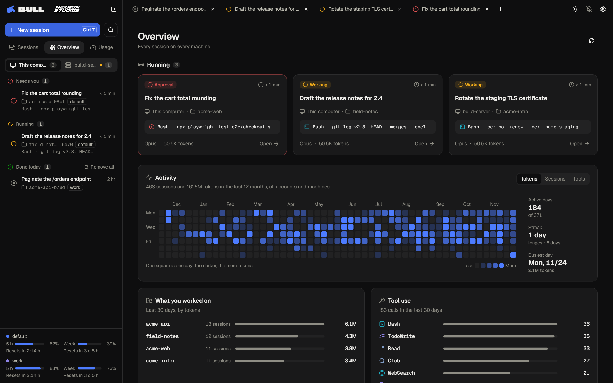
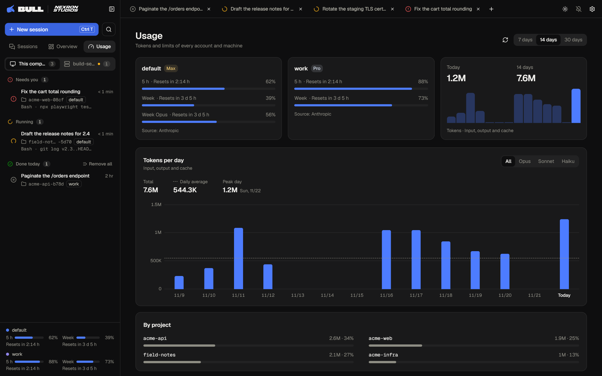
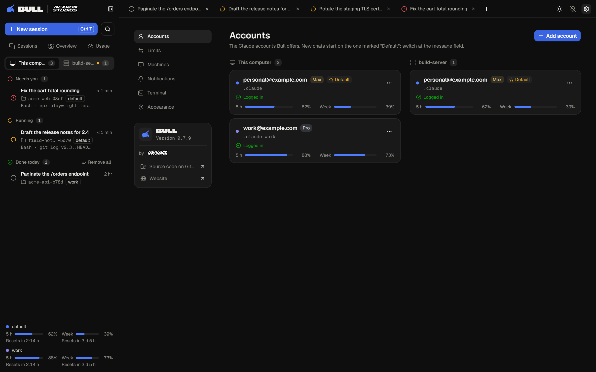
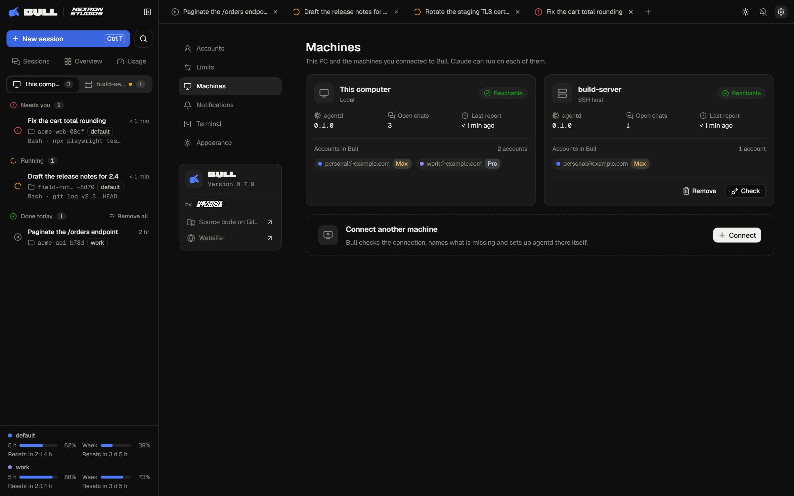
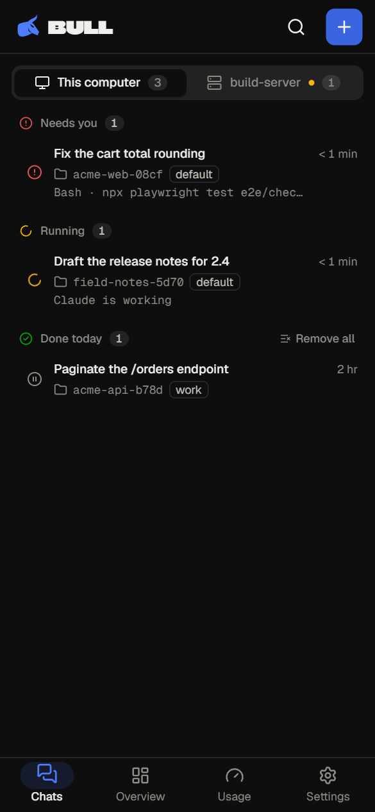
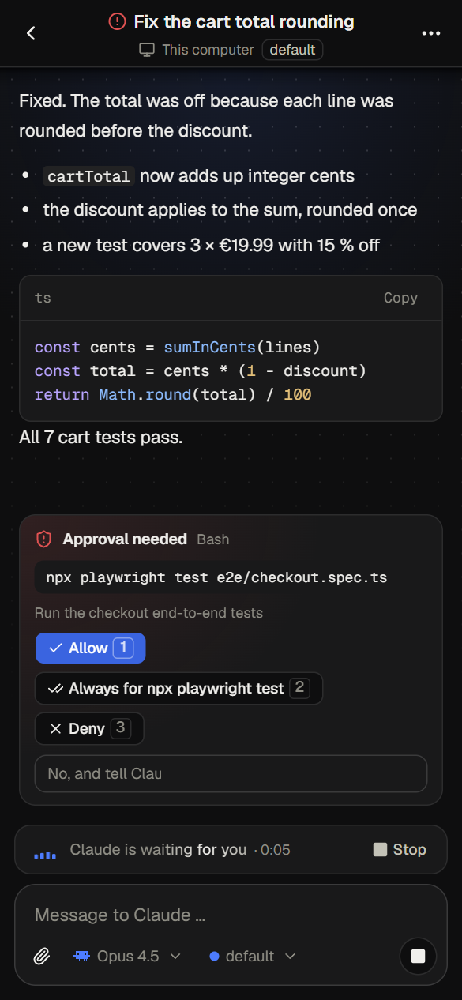

<div align="center">

<picture>
  <source media="(prefers-color-scheme: dark)" srcset="docs/brand/readme-banner-dark.svg">
  <source media="(prefers-color-scheme: light)" srcset="docs/brand/readme-banner-light.svg">
  
</picture>

<br><br>


</div>

<br>

Bull is a desktop app that shows your Claude Code sessions as chats in tabs. Each tab runs the
real Claude Code under the account you pick, on this PC or on another machine over SSH. Approvals,
questions and plans become buttons, and you see every tool call as it happens.

|                      |                                                                               |
| -------------------- | ----------------------------------------------------------------------------- |
| 💬 **Chat tabs**     | Every session is a tab with a live chat, tool calls and approvals.            |
| 👤 **Every account** | Pick the Claude account per chat and move a chat to another one later.        |
| 🖥️ **Every machine** | Sessions on other machines run over SSH and keep running when you close Bull. |



## Screenshots

<table>
  <tr>
    <td width="50%"></td>
    <td width="50%"></td>
  </tr>
  <tr>
    <td><b>Overview.</b> What runs on every machine, a year of activity, projects and tools.</td>
    <td><b>Usage.</b> Quota left per account and tokens per day, project, machine and model.</td>
  </tr>
  <tr>
    <td></td>
    <td></td>
  </tr>
  <tr>
    <td><b>Accounts.</b> Every Claude login on every machine, with its plan and quota.</td>
    <td><b>Machines.</b> This PC and the machines you connected, with their agentd and open chats.</td>
  </tr>
</table>

<p align="center">
  
  &nbsp;&nbsp;
  
  <br>
  <sub>On a narrow window Bull switches to its phone layout.</sub>
</p>

The screenshots show made-up data. See [Screenshots](#screenshots-1) under Develop for how they are made.

## Features

- **Live chat.** Text streams in as Markdown with highlighted code. Thinking folds into
  "Thought for n s". Tool calls group into one chain; edits show their diff.
- **Talking back.** Approvals as buttons (allow, always, deny, or tell Claude what to do
  instead), questions with options, plans you accept or send back. Up to 10 images per message.
- **Model and mode** per session: Opus, Sonnet or Haiku; ask first, allow edits, auto or plan
  first. Continue any earlier session.
- **Accounts.** Every `~/.claude` and `~/.claude-<name>` profile can be an account. Switch a chat
  to another account and the session moves with it. When an account hits its limit, Bull moves
  the chat or waits for the reset, as you set it.
- **Machines.** A setup assistant connects a Windows, Mac or Linux machine over SSH and
  installs `agentd` there. Claude keeps running on it when Bull closes or the connection drops.
- **Around the chat.** Sidebar grouped by what needs you, notifications, search, a terminal per
  folder, light and dark theme, phone layout.

## Getting started

### Requirements

- Windows 11 or macOS (Apple silicon or Intel).
- [Claude Code](https://docs.anthropic.com/en/docs/claude-code) installed, `claude` on the
  PATH, and logged in once.
- To build: Node 22 and Rust 1.90 with the MSVC toolchain.

### Install

Download `NEXRON-Bull_<version>_x64-setup.exe` from the
[latest release](https://github.com/nexron-studios/NEXRON-Bull/releases/latest), run it and start
NEXRON-Bull from the Start menu. The installer is not signed yet, so Windows SmartScreen asks first:
**More info › Run anyway**.

On a Mac, download `NEXRON-Bull_<version>_universal.dmg` from the same release and drag NEXRON-Bull
into Applications. It is not notarised yet, so macOS refuses the first start: right-click NEXRON-Bull ›
**Open**, or on macOS 15 and later **System Settings › Privacy & Security › Open Anyway**.

To build the installer yourself:

```bash
npm ci
npm run app:build
```

The installers land in `src-tauri/target/release/bundle/` (`nsis/` and `msi/`).

### First steps

1. **Add an account.** Settings › Accounts › **Add account**. _Already logged in_ takes a
   profile Claude Code already has (`~/.claude` is your default login). _New login_ creates a
   new profile folder and opens a terminal to log in there. Bull offers only the accounts you add.
2. **Start a chat.** **New session** (Ctrl T). Pick the folder, the account, the model and the
   mode, then write. _Continue_ lists earlier sessions; the Overview has them all.
3. **Answer Claude.** When Claude asks for approval, press **1** (allow), **2** (always) or
   **3** (deny), or type what it should do instead. The chat moves to _Needs you_ until you answer.
4. **Switch the account.** Use the account menu under the message field or **Switch** in the
   right panel. The session and its history move along. Settings › Limits decides what happens
   when an account runs out: move the chat, ask first, or wait.
5. **Connect another machine.** Settings › Machines › **Connect**. Enter the address or pick a
   host from `~/.ssh/config`. Bull checks the SSH login, tells you what is missing (a key, a host
   key) and installs `agentd` there. The machine needs Windows, macOS or Linux, an SSH server
   and Claude Code logged in. A Mac or Linux machine downloads `agentd` from the GitHub release
   of your Bull version.

## How it works

Bull never shows a terminal for Claude. Each tab runs `claude -p` with stream-json in and out,
under the account's `CLAUDE_CONFIG_DIR`. The Rust crate `agentd` starts Claude, streams its
events to the window and passes messages, images, interrupts and approvals back. `agentd serve`
runs in the background on every machine (localhost only, token in the user folder), so Claude
keeps working when the window closes. Another machine is reached through `agentd connect` over
`ssh -T`; history, profiles and usage come from the transcripts on that machine.

## Bull on the phone

The same app runs in a phone browser (iPhone and Android, installable as a PWA) and reaches the
chats of a server through a small bridge (`bridge/`, Node 22.6 or newer). The bridge listens on
`127.0.0.1:3060` only; a reverse proxy serves the built app and passes `/ws` to it. Each device
signs in with its own long token, sent as the first WebSocket message, and the bridge accepts
only the page origin it is told. It runs one `agentd connect` per device and machine and ends it
when the device goes away; Claude keeps running under `agentd serve`. The phone takes over the
tabs that run there, shows their questions and sends approvals; the desktop drops a card the
phone decided. Closing such a tab on the phone only stops watching it; the app that started it
keeps it running. Terminals, logging in and the machine setup stay in the desktop app.

Set it up on the server (Windows, same user as Bull's `agentd`):

```powershell
cd bridge
npm ci --omit=dev
npm run token -- phone      # prints the token once; only its hash is kept
powershell -File deploy\register-bridge-task.ps1 -Origin https://<host>
```

The token hashes live in `%USERPROFILE%\.nexron-chat\bridge-tokens`; deleting a line locks that
device out. `bridge/deploy/Caddyfile.bull.template` is the proxy block (tailnet only), and
`npm run build` puts the app into `dist/`. To try it locally, run a bridge on a side port and let
Vite proxy `/ws` to it: `BULL_BRIDGE_PORT=3066 BULL_BRIDGE_ORIGINS=http://localhost:1476 npm start`
in `bridge/`, then `BULL_BRIDGE_URL=ws://127.0.0.1:3066 npx vite --port 1476`.

## Develop

```bash
npm ci
npm run app:dev      # Tauri window, Vite on port 1460
npm test             # frontend tests (Vitest)
npm run test:rust    # agentd tests with a fake Claude
npm run test:bridge  # phone bridge tests (after npm ci in bridge/)
npm run build        # type check and build
npm run format:check
```

**Other machines.** After changing `agentd/`, install it again: Settings › Machines › Check ›
_Install agentd again_, or from a fresh build:

```powershell
powershell -File scripts/deploy-agentd.ps1 <host>
```

### Screenshots

```bash
node scripts/readme-screenshots/capture.mjs
```

Rebuilds `docs/screenshots/` from the real frontend in a headless browser (Windows, needs cargo and
`playwright-cli`). The data is made up: demo home folders with `example.com` accounts and `acme-*`
projects, a real `agentd stdio` per demo machine, and a stand-in Claude that answers from a script.
Only the Tauri shell and the plan quota are simulated. Nothing touches your own profiles.

### Brand

`public/favicon.svg` is the one source of the bull. After changing it:

```bash
npm run icons        # Tauri and PWA icons
uv run --with fonttools --with brotli docs/brand/generate_readme_banner.py docs/brand/banner.json
```

`node docs/design/build.mjs` renders the Figma design as HTML into `docs/design/out/`, see
[docs/design/README.md](docs/design/README.md).

---

<div align="center">
<sub>Bull is a NEXRON Studios tool. Banner from docs/brand/banner.json.</sub>
</div>
